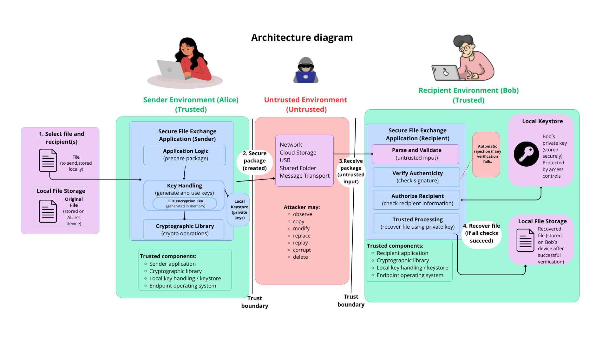

# Secure File Exchange Platform

## Secure Digital Document Vault

### D1 — Understand Security

*Architecture, Trust Boundaries and Security Mapping*

*Course:* Cryptography  
*Professor:* Dra. Rocío Aldeco  
*Team:* Team 03  

*Team members:*
- Castro Delgado Daniela Beatriz - 319039414
- González Frías Ana Paula - 319285099 
- Hernández Rubio Dana Valeria - 317345153
- Murillo Rodríguez Sarah Sofia - 422130448
- Roque Ruiz Bruno Ezequiel - 318276588

*Date:* 26/09/2026

# 1. System Overview
## 1.1 What problem does the system solve?

The Secure File Exchange Platform (Secure Digital Document Vault) solves the problem of securely exchanging files between a sender (Alice) and one or more authorized recipients (Bob, Carol, etc.) over a channel or storage medium that is not trusted (public network, cloud, USB drive, shared folder, etc.).

The system assumes that the intermediate channel/storage can be observed, copied, modified, replaced, or tampered with by an attacker. Therefore, the file must be protected before it leaves the sender's environment and verified before it is accepted by the recipient.

## 1.2 Core features

- Encryption of the file content (AEAD) before it leaves the sender's trusted environment.
- Generation of a file key and individual protection of that key for each authorized recipient (hybrid encryption).
- Packaging of the encrypted file together with control metadata (recipient, version, timestamp, etc.).
- Digital signature of the package to guarantee sender authenticity.
- Signature and integrity verification on the recipient side before processing the package (fail-closed).
- Decryption and recovery of the original file only if all verifications succeed.
- Support for multiple authorized recipients per file.
- Local storage of private keys (keystore) on both ends.

## 1.3 What is explicitly out of scope (D1 stage)

- The choice of specific cryptographic algorithm (AEAD, hybrid scheme, signature, KDF) — to be defined in D2, D3, D5 and D6.
- Protection against a malicious sender: Alice is assumed to act in good faith.
- Compromise of the local endpoint/device (malware, physical access): out of scope for this project.
- Large-scale key management infrastructure (full PKI).
- Availability guarantees for the transfer channel (resilience against DoS).
- User interface / user experience design.

# 2. Architecture Diagram and Trust Boundaries
The diagram below shows the overall architecture of the system, identifying trusted components, untrusted components, trust boundaries, and the main data flows for the Alice → untrusted environment → Bob scenario.



**Trust boundary 1:** exit from Alice's zone.  
**Trust boundary 2:** entry into Bob/Carol's zone.

## 2.1 Component classification

| Category | Elements |
|---|---|
| **Trusted components** | Alice's original file; Alice's private signing key; protection module (AEAD encryption + packaging + signature); file key generation; recipients' public keys (used as input); signature/integrity verification at Bob's side; Bob's private key; file key recovery; AEAD decryption and verification; recovered file; fail-closed logic. |
| **Untrusted components / data** | The secure package once it leaves Alice's environment; the transfer channel or storage medium (network, disk, cloud, USB); the package as received by Bob (treated as untrusted input until verified). |
| **Trust boundaries** | Boundary 1: border between Alice's trusted zone and the untrusted environment. Boundary 2: border between the untrusted environment and Bob/Carol's trusted zone. |
| **External actors** | Alice (sender); Bob and Carol (authorized recipients); active/passive attacker able to observe, copy, modify, replace, replay, or corrupt the package. |

## 2.2 Where each cryptographic operation happens

- **Encryption:** inside the protection module, within Alice's trusted zone, before Boundary 1.
- **Signing:** also inside Alice's protection module, using her private key, before leaving her zone.
- **Signature/integrity verification:** in Bob's zone, immediately upon receiving the package (fail-closed if it fails).
- **Key storage:** private keys remain in local keystores; they never cross trust boundaries in plaintext.

## 2.3 Main data flows

1. File + Alice's private key → protection module.
2. Protection module → secure package generated (encrypted + signed).
3. The package crosses Boundary 1 toward the untrusted channel/storage.
4. The package crosses Boundary 2 and reaches Bob/Carol's environment.
5. Signature/integrity verification and file key recovery.
6. AEAD decryption and verification.
7. Recovery of the original file, or a secure rejection (fail-closed) if any verification fails.

# 3. Security Requirements
The following security requirements the system must guarantee are listed below, written as verifiable properties:

1. **Confidentiality of file content.**  
   An attacker who obtains the encrypted package from the untrusted channel must not be able to learn the file content without possessing the correct private key of an authorized recipient.

2. **Confidentiality of the file key.**  
   An attacker who intercepts the package must not be able to recover the key protecting the file without the legitimate recipient's private key.

3. **Integrity of file content.**  
   Any unauthorized modification of the encrypted content must be detectable by the recipient before the file is recovered or used.

4. **Authenticity of the sender.**  
   The recipient must be able to verify, through cryptographic evidence, that the package was actually generated by the sender it claims to come from.

5. **Integrity of metadata.**  
   Any unauthorized alteration of control metadata must be detected before it is trusted or used.

6. **Confidentiality of private keys.**  
   Alice's and Bob's private keys must remain protected even if the local storage where they reside is compromised (never stored in plaintext).

7. **Protection against package tampering.**  
   A package that has been modified or corrupted in transit must be securely rejected (fail-closed), without exposing its content.

8. **Access restricted to authorized recipients.**  
   Only the recipients explicitly designated by the sender at protection time will be able to recover the original file.

9. **Replay resistance.**  
   The system must be able to identify or handle a previously valid package that is resent by an attacker, according to the defined replay policy.

10. **No information disclosure on failure.**  
    When a verification fails, the system must not leak internal information that could help an attacker refine an attack.

# 4. Threat Model

## 4.1 Assets to protect

- File content.
- File key / file recovery material.
- Package metadata (name, timestamp, recipient identifier, version).
- Private keys (Alice's and Bob's).
- User credentials (keystore passwords).
- Validity of the digital signature / sender identity.
- List of authorized recipients.

## 4.2 Adversaries

- External attacker with access to the channel/storage.
- Malicious recipient attempting to use the system outside authorized boundaries.
- Attacker modifying metadata to alter the system's behavior.
- Attacker with temporary access to the device (physical or remote).

## 4.3 What the attacker can do

- Passive observation (eavesdropping) of all traffic/storage in the untrusted channel.
- Active modification of bits, blocks, or metadata in the package.
- Replacement/injection: substituting a legitimate package, injecting malformed packages, or replacing a public key.
- Replay of a previously valid package.
- Suppression/deletion of packages, affecting availability.
- Attempting to get the system to accept a fake public key (without physical access to the keystore).

## 4.4 What the attacker cannot do

- No execution or physical access to Alice's or Bob's local OS/hardware.
- Not assumed capable of breaking the underlying cryptographic primitives.

## 4.5 Mapping: Asset → Threat → Attack Scenario → Security Requirement → Design Constraint

| Asset | Threat | Attack scenario | Security requirement | Design constraint |
|---|---|---|---|---|
| *File content* | Disclosure | The attacker obtains the package from the channel and tries to read the content. | Only authorized recipients can access the content. | The file must be encrypted before leaving the trusted environment. |
| *File key* | Disclosure | The attacker intercepts the package and tries to obtain the key protecting the file. | Only authorized recipients can recover the key. | The file key must be individually protected per recipient. |
| *Package metadata* | Modification / Tampering | The attacker alters metadata in transit or storage. | Any unauthorized modification must be detected. | Metadata must be authenticated together with the content. |
| *Sender identity* | Spoofing | The attacker builds or modifies a package presenting it as coming from Alice. | The recipient must verify the real authenticity of the sender. | The package must include verifiable authenticity evidence. |
| *Package / channel* | Replay | The attacker resends an old, previously valid copy of the package. | The system must identify or discard repeated packages. | The package must include information that distinguishes each specific send. |
| *Private keys* | Theft or compromise | The attacker accesses local storage and tries to extract the private key. | Private keys must remain protected even if local storage is compromised. | Private keys must not be stored in plaintext. |
| *Complete secure package* | Manipulation / corruption | The attacker corrupts the package and the recipient processes it unaware. | Manipulated packages must be rejected (fail-closed). | The system must validate integrity before exposing the content. |
| *List of recipients* | Unauthorized access | A non-selected user attempts to recover the file. | Only designated recipients will be able to recover the file. | Recipient selection is fixed at protection time. |
| *User credentials* | Interception / sniffing | The attacker captures plaintext traffic during login. | Credentials must be protected in transit and at rest. | Use of encrypted protocols/storage, never plaintext. |

# 5. Trust Assumptions

## 5.1 Alice's zone (sender)
| Component | Trust level | Security assumption (justification) |
|---|---|---|
| **Alice (external actor)** | Trusted | Assumed to act in good faith and to only send to recipients of her choosing. The design does not protect against a malicious sender. |
| **Original file (plaintext)** | Partially trusted | Assumed valid before entering the protection module; its future confidentiality depends entirely on encryption being applied correctly. |
| **Alice's private key (signature)** | Trusted | Assumed that Alice's device adequately protects it. If this fails, an attacker could sign forged packages impersonating Alice. |
| **Protection module (AEAD + signature)** | Trusted | Assumed to be correctly implemented (correct primitives, unique nonces) and not modified by an attacker. |
| **File key generation** | Trusted | A cryptographically secure random number generator (CSPRNG) is assumed. If weak, the system's entire confidentiality would collapse. |
| **Recipients' public keys** | Partially trusted | Obtained from a channel external to the diagram; assumed to have been obtained authentically (verified out-of-band). If this fails, a MITM attack on key registration occurs. |
| **Secure package generated** | Trusted → Untrusted once crossing Boundary 1 | Its protection (encryption + signature) is the only thing upholding trust once it leaves the controlled environment. |

## 5.2 Untrusted zone (transfer / storage)
| Component | Trust level | Security assumption (justification) |
|---|---|---|
| **Transfer/storage channel** | Untrusted | By design, the attacker is assumed to have full control: observe, copy, modify, replace, replay, or delete the package. |
| **Attacker (active/passive)** | Adversary | Full access to the channel/storage is assumed, but not to Alice's or Bob's trust zones. |

## 5.3 Bob/Carol's zone (recipients)
| Component | Trust level | Security assumption (justification) |
|---|---|---|
| **Package received** | Untrusted until verified | Even if it arrives encrypted and signed, it is treated as hostile input until signature and integrity are validated. |
| **Signature/integrity verification** | Trusted | Assumed that this code is correct and has not been tampered with; it acts as the gatekeeper for the rest of the process. |
| **Bob's private key** | Trusted | Protected on his device, with no third-party access. |
| **File key recovery** | Trusted | Depends on Bob's private key being intact and the package having already passed verification. |
| **AEAD decryption and verification** | Trusted | Assumed to correctly detect any tampering with the ciphertext and to fail securely if authentication fails. |
| **Recovered original file** | Trusted (conditioned) | Trusted only if all preliminary checks were successful. |
| **Fail-closed** | Trusted | Assumed that this logic does not reveal sensitive information upon failure and correctly blocks unverified data. |

## 5.4 Cross-cutting assumption (outside the diagram, but critical)
| Component | Trust level | Security assumption (justification) |
|---|---|---|
| **Alice's and Bob's local environment (OS/hardware)** | Trusted, with an explicit caveat | Assumed that no local device is compromised. If the local machine were compromised, no cryptographic protection could prevent the private key or plaintext file from being leaked. |


# 6. Attack Surface Review
## 6. Attack Surface Review

The attack surface is organized according to the system's two trust boundaries.

### 6.1 Boundary 1 — Alice's environment → Untrusted channel

| Interface / component | What could go wrong? | Security property at risk |
| :--- | :--- | :--- |
| Secure package generated (output) | It is the only exposed surface when leaving the trusted environment; its cryptographic protection is the only thing preventing an observer from extracting information. | Confidentiality, integrity |
| Recipient public key import interface | If the public key is obtained via an unverified channel, an attacker can substitute it before encryption (MITM). | Confidentiality of content |
| Password entry | If the password unlocking Alice's keystore is captured (keylogging, unmasked field), the private key is compromised. | Confidentiality of private keys |
| CLI arguments | Paths, passwords, or keys passed as parameters may be exposed in shell history or process logs. | Confidentiality of credentials and keys |

### 6.2 Boundary 2 — Untrusted channel → Bob/Carol's environment

| Interface / component | What could go wrong? | Security property at risk |
| :--- | :--- | :--- |
| Secure package parser | Malformed fields, out-of-range sizes, unexpected data types, or unsupported algorithm versions. | Availability, integrity |
| Recovered file input | Malicious filenames or path traversal when writing the decrypted file to disk. | File system integrity |
| Control metadata | Recipient identifiers, algorithm ID, version, and timestamps modifiable prior to verification. | Integrity, authenticity |
| Key interfaces / local keystore | Access to Bob's keystore and password/PIN request to unlock his private key. | Confidentiality of private keys |
| Transport / buffer channel | Reading, modification, replacement, replay, or deletion of packets in transit or at rest. | Confidentiality, integrity, availability |
| Error handling and logging | Error messages or logs that could leak internal information without a generic fail-closed scheme. | Confidentiality of internal information |
| Password entry at Bob's side | Same as Alice: capturing the password compromises the private key. | Confidentiality of private keys |
| Signature verification | Implementation errors could accept invalid or forged signatures. | Authenticity |

### 6.3 Realistic attacker capabilities (summary)

* Passive observation: can read and copy all traffic/storage in the untrusted channel.
* Active modification: can alter packet bits/blocks and metadata.
* Replacement/injection: can substitute a legitimate package, inject malformed packages, or replace a public key.
* Replay: can capture a valid package and resend it later.
* Suppression/deletion: can block or delete packages, affecting availability.
* Out of scope: no physical/execution access to local devices, and no ability to break underlying cryptographic primitives.

# 7. Unresolved Security Questions
The following cryptographic design decisions are intentionally left open at this stage:

* Which AEAD algorithm will be used (AES-GCM vs. ChaCha20-Poly1305) and with what key size?
* Which hybrid encryption scheme will protect the file key per recipient (RSA-OAEP, ECIES, or other)?
* Which digital signature algorithm will be used (RSA-PSS, ECDSA, EdDSA) and exactly which fields will be signed?
* How will nonces/IVs be generated and managed, avoiding reuse?
* What serialization/canonicalization format will be used for metadata before signing?
* What KDF and parameters will protect private keys at rest (encrypted keystore)?
* What mechanism will detect/mitigate replay attacks (timestamps, nonces, counters)?
* How will the key lifecycle be managed (generation, identification, rotation, revocation)?
* What minimal error information will be exposed without leaking details useful to an attacker?

### D2 - Cryptographic Implementation

### Overview

During the D2 development phase, the Secure Digital Document Vault
project implements authenticated encryption and decryption of digital
documents using AES-256-GCM.

The objective of this phase is to protect the confidentiality and
integrity of digital files while ensuring that unauthorized
modifications can be detected during decryption.

The implementation was developed in Python using the cryptography
library and validated through automated tests using pytest.

# 1. Encryption Design

### 1.1 Selected AEAD Algorithm

The selected algorithm is AES-256-GCM (Advanced Encryption Standard
in Galois/Counter Mode), an Authenticated Encryption with Associated
Data (AEAD) algorithm.

AES-256-GCM provides:

- *Confidentiality:* Protects the content of digital documents
  through symmetric encryption.
- *Integrity:* Detects unauthorized modifications to encrypted data.
- *Authentication:* Verifies that encrypted data and associated
  metadata have not been modified without authorization.

The implementation uses the AESGCM class provided by Python's
cryptography library.

### 1.2 Key Size and Generation

The system uses 256-bit (32-byte) symmetric encryption keys.

A new random encryption key is generated for each encryption
operation using:

python
key = AESGCM.generate_key(bit_length=256)


This approach avoids using a fixed encryption key for all
documents.

For the current prototype, encryption keys are stored separately
in local .key files.

These files are excluded from Git version control and must not
be published or shared with unauthorized users.

### 1.3 Nonce Strategy

Each encryption operation generates a random 96-bit (12-byte)
nonce using:

python
nonce = os.urandom(12)


The nonce is stored in the encrypted container because it is
required during decryption and does not need to remain secret.

AES-GCM requires that the same nonce must not be reused with
the same encryption key.

To reduce the risk of nonce reuse, the application generates
a new encryption key and a random nonce for every operation.

### 1.4 Metadata Authentication Strategy

The application uses Additional Authenticated Data (AAD)
to protect the integrity of file metadata.

The authenticated metadata includes:

- filename: Original filename.
- algorithm: Encryption algorithm used.
- version: Version of the encrypted container format.
- created_at: Date and time of encryption.

Before encryption, the metadata is serialized into JSON
using sorted keys:

python
aad = json.dumps(metadata, sort_keys=True).encode("utf-8")


The resulting AAD is supplied to AES-GCM during encryption
and must match during decryption.

Although the metadata remains readable, any unauthorized
modification causes authentication to fail.

### 1.5 Encrypted File Format

The encrypted document is stored in a JSON-based container
with the .vault extension.

The container includes:

- Authenticated file metadata.
- The encryption nonce.
- The ciphertext, including the AES-GCM authentication tag.

Example structure:

json
{
    "metadata": {
        "filename": "documento.txt",
        "algorithm": "AES-256-GCM",
        "version": 1,
        "created_at": "2026-10-16T12:00:00+00:00"
    },
    "nonce": "<hex-encoded nonce>",
    "ciphertext": "<hex-encoded ciphertext and authentication tag>"
}


The encryption key is not included in the .vault container.

# 2. Security Decisions

### 2.1 Why AEAD Instead of Encryption + Hash?

AEAD was selected because it combines encryption and
authentication within a single cryptographic construction.

Using encryption with a conventional hash does not provide
equivalent protection, since an attacker who modifies the
ciphertext could also calculate a new hash.

AES-256-GCM generates an authentication tag that depends on
the encryption key, nonce, ciphertext, and associated data.

This allows the application to detect unauthorized modifications
without requiring a separate authentication mechanism.

Although encryption combined with a properly implemented
Message Authentication Code (MAC) can also provide secure
authenticated encryption, AEAD simplifies implementation
and reduces the risk of cryptographic design errors.

### 2.2 What Happens if a Nonce Repeats?

Reusing the same nonce with the same AES-GCM encryption key
can seriously compromise security.

Nonce reuse can:

- Reveal relationships between encrypted plaintexts.
- Compromise confidentiality.
- Facilitate authentication forgery attacks.
- Allow attackers to exploit weaknesses caused by repeated
  encryption parameters.

To reduce this risk, the application generates a new
256-bit encryption key and a random 96-bit nonce for
every encryption operation.

### 2.3 What Attacker Are We Defending Against?

The system is designed to defend against an attacker who
can access, copy, intercept, or modify encrypted files,
but does not possess the corresponding secret encryption key.

The attacker may attempt to:

- Read confidential information from encrypted documents.
- Modify encrypted content.
- Alter authenticated metadata.
- Replace encrypted data with manipulated information.
- Decrypt documents using an incorrect key.

AES-256-GCM protects the confidentiality of encrypted
documents and detects unauthorized modifications during
authenticated decryption.

However, the current prototype does not protect against
attackers who obtain the secret encryption key or compromise
the computer where plaintext files and keys are stored.

The system also does not prevent deletion of encrypted files
or replacement of a complete valid encrypted container
with another valid container and its corresponding key.

# 3. Implementation

The cryptographic implementation is organized into separate
Python modules.

| File | Description |
|------|-------------|
| D2/src/encryption.py | Implements AES-256-GCM encryption, key generation, nonce generation, and metadata authentication. |
| D2/src/decryption.py | Implements authenticated decryption and authentication failure handling. |
| D2/main.py | Demonstrates the encryption and decryption workflow. |
| D2/requirements.txt | Defines the required Python dependencies. |

During encryption, the application generates a new key and
nonce, encrypts the document, and creates a .vault container.

During decryption, the application verifies the AES-GCM
authentication tag before writing the recovered plaintext.

If authentication fails, the operation is rejected and
no decrypted output file is generated.

# 4. Automated Tests

The implementation includes five automated tests developed
using pytest.

| Test | Objective | Expected Result |
|------|-----------|-----------------|
| Successful encryption and decryption | Verify that the original file can be recovered. | Recovered content matches the original. |
| Incorrect encryption key | Verify rejection of invalid keys. | Authentication fails. |
| Modified ciphertext | Verify detection of altered encrypted content. | Decryption is rejected. |
| Modified metadata | Verify integrity protection through AAD. | Authentication fails. |
| Multiple encryptions | Verify that repeated encryption produces different outputs. | Different ciphertexts, nonces, and keys. |

All five tests passed successfully during development.

To execute the tests, navigate to the D2 directory and run:

bash
python -m pytest -v -s


Expected result:

text
================ 5 passed ================


# 5. Security Limitations

The current implementation is an educational prototype.

Its main limitations include:

- Encryption keys are stored in local unencrypted .key files.
- No centralized key management system is implemented.
- User authentication and authorization are not implemented.
- Plaintext files are not securely erased after encryption.
- The system does not implement secure key backup or recovery.
- The implementation has not undergone an independent
  security audit.

A production version should incorporate secure key storage,
access control, and additional security mechanisms.

# 6. Development and Collaboration

The D2 implementation was developed collaboratively using
Git and GitHub.

The team organized its work into separate development branches
and integrated contributions through Pull Requests.

| Team Member | Contribution |
|-------------|--------------|
| Daniela | AES-256-GCM encryption module. |
| Ana Paula | Authenticated decryption module. |
| Sarah | Basic encryption and decryption tests. |
| Dana | Ciphertext and metadata integrity tests. |
| Bruno | Multiple encryption test. |

### D3 Hybrid Encryption 

# 1. Hybrid Design Explanation

## Why hybrid encryption is used

Public key cryptography (such as ECIES-secp256k1) is computationally intensive and not designed for encrypting large payloads directly. Conversely, symmetric encryption algorithms like AES-256-GCM are extremely fast and efficient at processing arbitrarily large files. Hybrid encryption combines the strengths of both paradigms: symmetric encryption encrypts the actual document payload using a randomly generated AES key, while asymmetric encryption securely transmits and shares this AES key with target recipients.

## Why symmetric encryption is still needed

Symmetric encryption provides high-throughput data processing and authenticated confidentiality (AEAD) for the document content itself. Without symmetric encryption, encrypting large documents with public-key algorithms would result in unacceptable performance overhead, strict size limitations, and severe computational inefficiency.

## Why per-recipient key encryption is required

Per-recipient key encryption enables secure multi-recipient document sharing without needing to duplicate or separately encrypt the main document payload for each user. A single file encryption key (FEK/AES key) encrypts the document payload once. That FEK is then encrypted separately using each authorized recipient's public key (ECIES), allowing each authorized user to unwrap the same underlying AES key using their private key.

# 2. Security Decisions

## How do recipients identify their key?

Each recipient entry inside the vault container contains a unique identifier (id). This id is computed as the deterministic SHA-256 fingerprint of the recipient's compressed public key (get_key_fingerprint). Upon opening a container, a recipient computes the SHA-256 fingerprint of their public key and searches the recipients list for a matching id to locate their encrypted AES key.

## What happens if an attacker modifies the recipient list?

The entire list of recipients (including IDs and encrypted keys) is serialized deterministically into the Authenticated Additional Data (AAD) bound to the AES-GCM ciphertext. If an attacker tampers with, adds, or removes any recipient or encrypted key entry, the reconstructed AAD during decryption will not match the tag computed at encryption time. Consequently, AES-GCM authentication fails immediately with an InvalidTag exception, preventing tampered containers from being decrypted.

## What happens if the public key is wrong?

If an invalid or corrupted public key is provided during encryption:

Format validation checks fail (e.g., verifying 33-byte length and valid compressed SECP256k1 prefix 0x02 or 0x03).

If an unauthorized recipient's key is used, their private key will fail to recover the correct AES key during ECIES decryption, raising an exception during key unwrapping or triggering an authentication failure (InvalidTag) when attempting to decrypt the file payload.

# 3. GitHub Requirements & Deliverables

Our repository fulfills all project requirements for Deliverable D3:

Inclusion of New Functionalities: Implementation of multi-recipient ECIES key management (src/key_management.py), canonical container handling with AAD integrity (src/container.py), AES-GCM file encryption (src/encryption.py), and multi-recipient file decryption (src/decryption.py).

Pull Request & Code Review: Changes introduced via Pull Request workflow on GitHub, including peer code reviews and discussion threads prior to merging into main.

Unit Tests & Continuous Integration: Comprehensive test suite with 100% test coverage across 7 test files (test_basic.py, test_container.py, test_decryption.py, test_encryption.py, test_key_management.py, test_multiple_encryptions.py, test_security.py). Automated test execution is configured using GitHub Actions (.github/workflows/python-tests.yml).

Updated README: Complete documentation outlining project structure, architecture decisions, threat model defenses, and usage instructions.
---

# D3 – Final Integration, Implementation, and Security Validation

> **Documentation note:** This section describes the integrated D3 checkpoint. Earlier D1 and D2 sections are preserved as evidence of the project's development and may describe earlier implementations.

## 1. Integration Overview

Secure Digital Document Vault combines **AES-256-GCM** for document encryption with **ECIES (secp256k1)** for protecting the file key for multiple recipients. A document is encrypted **once**, while its randomly generated AES key is encrypted separately for each authorized recipient.

The integrated Python implementation supports encrypted `.vault` containers, recipient identification, authenticated metadata, authorized decryption, rejection of unauthorized users, and detection of ciphertext tampering.

## 2. Project Modules

The main implementation is located in `D2/src/`:

| Module | Responsibility |
| --- | --- |
| `encryption.py` | Generates a fresh AES-256 key and 96-bit nonce, encrypts the file using AES-GCM, wraps the file key for each recipient, and creates the encrypted container. |
| `key_management.py` | Generates secp256k1 key pairs, calculates SHA-256 public-key fingerprints, and encrypts/decrypts file keys with ECIES. |
| `container.py` | Serializes, reads, and validates the JSON-based `.vault` container and constructs the authenticated metadata representation. |
| `decryption.py` | Validates the container, identifies the authorized recipient, unwraps the AES key, authenticates and decrypts the document, and checks output handling. |

### Key Formats

- AES file key: **256 bits (32 bytes)**, generated anew for each encrypted file.
- AES-GCM nonce: **96 bits (12 bytes)**, generated randomly for each encryption.
- ECIES private key: **32 bytes**.
- Compressed secp256k1 public key: **33 bytes**.
- Recipient identifier: **SHA-256 fingerprint**, represented as **64 hexadecimal characters**.

Each recipient has their own public/private key pair. Private keys are **not stored** in the `.vault` container.

## 3. Encryption Workflow

1. The sender selects a local document and at least two distinct authorized recipients.
2. The application generates a fresh random 256-bit AES file key and a 96-bit nonce.
3. It prepares the document metadata and full recipient list as **Additional Authenticated Data (AAD)**.
4. It encrypts the document **once** with **AES-256-GCM**.
5. It encrypts the same AES file key separately using each recipient's ECIES public key.
6. It stores metadata, recipient identifiers and wrapped keys, nonce, and ciphertext in a `.vault` file.

```text
Original document
       |
       v
Fresh AES-256 key + 96-bit nonce
       |
       v
AES-256-GCM encryption <--- authenticated metadata + recipient list (AAD)
       |
       +-------------------+
       |                   |
       v                   v
ECIES for Alice       ECIES for Bob
(public key)          (public key)
       |                   |
       +---------+---------+
                 |
                 v
        Encrypted .vault file
```

**Why hybrid encryption?** AES efficiently encrypts the document, while ECIES allows each recipient to recover the same AES key with their own private key. The document does not need to be encrypted again for every recipient.

## 4. Decryption Workflow

1. The recipient opens the `.vault` file, and the application validates its structure.
2. The application identifies the recipient using the fingerprint associated with their private key.
3. It locates the corresponding encrypted AES file key in the recipient list.
4. ECIES recovers the AES key using the recipient's private key.
5. The application reconstructs the AAD and attempts AES-GCM authenticated decryption.
6. If authentication succeeds, the original file is written to the output location. Otherwise, the operation is rejected.

An unauthorized recipient cannot select a matching wrapped key. Changes to authenticated ciphertext, metadata, or recipient information cause AES-GCM authentication to fail.

## 5. Encrypted `.vault` Container

The `.vault` file is a JSON-based container. The following is an **illustrative example**, not a literal generated file:

```json
{
  "metadata": {
    "filename": "confidential_document.txt",
    "algorithm": "AES-256-GCM",
    "key_encryption": "ECIES-secp256k1",
    "version": "1.0",
    "created_at": "example_timestamp"
  },
  "recipients": [
    {
      "id": "alice_public_key_fingerprint",
      "encrypted_key": "encrypted_AES_key_for_Alice"
    },
    {
      "id": "bob_public_key_fingerprint",
      "encrypted_key": "encrypted_AES_key_for_Bob"
    }
  ],
  "nonce": "encoded_nonce",
  "ciphertext": "encoded_ciphertext"
}
```

| Field | Purpose |
| --- | --- |
| `metadata` | Document name, algorithms, version, and creation information. |
| `recipients` | Authorized public-key fingerprints and an ECIES-encrypted AES key for each recipient. |
| `nonce` | Non-secret nonce required for AES-GCM decryption. |
| `ciphertext` | Encrypted document data with AES-GCM authentication information. |

The container does **not** include plaintext document content, plaintext AES file keys, or recipients' private keys.

## 6. Security Decisions

- **AES-256-GCM (AEAD):** Protects confidentiality and detects modifications to authenticated data.
- **ECIES with secp256k1:** Protects the file key independently for each recipient.
- **SHA-256 fingerprints:** Identify recipient public keys; fingerprints are identifiers, not secrets.
- **AAD:** Authenticates metadata and the complete recipient list without encrypting those fields.
- **Fresh key and nonce:** Each encrypted file receives a new AES key and random nonce; a nonce must never be reused with the same AES key.
- **Private-key separation:** Private keys remain outside the shared `.vault` file.

**Security scope:** AES-GCM authentication is not a digital signature and does not establish the sender's identity. Digital signature generation and verification are **not implemented** in the current D3 modules.

## 7. Automated Testing with PyTest

The team validated the integrated project with **42 passing automated tests locally**. The suite covers encryption/decryption, key management, fingerprints, multi-recipient behavior, invalid inputs, container validation, and tampering detection.

From the `D2` directory, run:

```bash
python -m pytest tests/ -v
```

The reported **42 passing tests** are a local result; a separate GitHub Actions run must be checked independently. Passing tests demonstrate expected behavior in tested cases, not the absence of all vulnerabilities.

## 8. GitHub Actions

The repository includes a **GitHub Actions workflow configured for automated testing**. Its purpose is to run the project's tests during the development and integration process.

```text
Code changes → GitHub Actions → PyTest → Test results
```

To inspect actual workflow runs, open the repository's **Actions** tab and review the relevant run and logs. Do not assume that the latest CI run passed solely because local tests passed.

## 9. D3 Demonstration

The script `D2/demo_d3.py` runs four scenarios using the integrated modules. It generates key pairs for **Alice** and **Bob** (authorized recipients) and **Charlie** (unauthorized).

| Scenario | Operation | Expected result |
| --- | --- | --- |
| 1. Encryption and decryption | Encrypt a sample document and decrypt it as Alice. | Recovered bytes match the original. |
| 2. Authorized sharing | Bob decrypts the **same** `.vault` file with his own private key. | Successful recovery. |
| 3. Unauthorized access | Charlie attempts to decrypt the file. | Rejected; no Charlie output file. |
| 4. Tampering detection | Modify a copy of the ciphertext and try to decrypt it. | Authentication fails; no recovered output. |

Run from `D2/`:

```bash
python demo_d3.py
```

Press **Enter** to advance between scenarios. When the checks pass, the final summary is:

```text
[PASS] Encryption and decryption
[PASS] Authorized sharing
[PASS] Unauthorized access rejected
[PASS] Modified document rejected

ALL 4 SECURITY SCENARIOS PASSED
```

Error messages during scenarios 3 and 4 are **expected rejection outcomes**, not unexpected failures.

### Generated Demonstration Files

The script saves its outputs in `D2/demo_files/`:

```text
D2/
├── src/
├── tests/
├── demo_d3.py
└── demo_files/
    ├── confidential_document.txt
    ├── confidential_document.vault
    ├── alice_decrypted.txt
    ├── bob_decrypted.txt
    └── modified_document.vault
```

The script removes known outputs from previous demonstrations before creating new ones. Files are kept after execution for inspection. `charlie_decrypted.txt` and `tampered_decrypted.txt` should **not** be created.

To exclude generated files from Git, add this line to the **repository root** `.gitignore`:

```gitignore
D2/demo_files/
```

The demonstration uses fictional data and generates fresh recipient keys each time; it does not implement persistent key storage.

## 10. Current Limitations

- **Digital signatures:** Proposed in D1, but not yet implemented in the current D3 code.
- **Persistent private-key management:** Secure storage, backup, and recovery are outside the current demonstration.
- **Graphical interface:** The current implementation uses Python modules and a command-line demonstration.
- **File transport:** `.vault` files can be transferred externally, but no dedicated cloud or network-sharing service is implemented.
- **Replay and deletion:** AES-GCM detects authenticated modifications but does not, by itself, prevent replay of an older valid container or deletion of files.

## 11. Team Contributions

| Team member | Main contribution |
| --- | --- |
| Daniela | AES-256-GCM encryption and multi-recipient integration (`encryption.py`). |
| Dana | ECIES key management and SHA-256 fingerprints (`key_management.py`). |
| Sarah | `.vault` container serialization and validation (`container.py`). |
| Ana Paula | Authorized decryption and authentication checks (`decryption.py`). |
| Bruno | GitHub Actions automated testing workflow and project documentation. |

The team integrated contributions using GitHub branches and Pull Requests.

## 12. Integration Results and Conclusion

The integrated D3 checkpoint combines AES-256-GCM encryption, ECIES-based key protection, multi-recipient access, and a structured `.vault` container. **42 automated tests passed locally**, and the four demonstration scenarios were successfully verified: authorized encryption/decryption, second-recipient access, unauthorized-user rejection, and ciphertext tampering detection.

These results support the functionality of the tested D2 and D3 components. The project remains a **development checkpoint**, with future work including persistent key management, digital signatures, a user interface, and dedicated secure file sharing.

# D5 — Digital Signatures and Secure File Verification

## Overview

Deliverable 5 extends the Secure Digital Document Vault with *Ed25519 digital signatures. Files are encrypted using **AES-256-GCM, while the AES file key is encrypted separately for each authorized recipient using **ECIES (secp256k1). The sender signs the encrypted container, and the recipient must verify the signature using a trusted sender public key **before* attempting key recovery or file decryption.

## Cryptographic Design

### Chosen signature algorithm

We selected *Ed25519*, a modern digital signature algorithm based on elliptic-curve cryptography. It provides strong authentication and integrity protection with compact keys and signatures. In this project, the raw Ed25519 private and public keys are each 32 bytes, and each signature is 64 bytes.

The src/digital_signature.py module implements:

- generate_signing_key_pair() — creates an Ed25519 key pair.
- get_signer_fingerprint() — calculates a SHA-256 fingerprint of the sender's public key.
- sign_data() — signs a byte sequence with the sender's private key.
- verify_signature() — verifies a signature using the sender's public key.

### What data is signed?

The D5 signature covers a canonical byte representation of these container fields:

| Field | Why it is protected |
|---|---|
| metadata | Protects the filename, algorithms, version, and creation timestamp from undetected modification. |
| recipients | Protects the authorized recipient list and encrypted AES keys. |
| nonce | Protects the AES-GCM nonce used for encryption. |
| ciphertext | Protects the encrypted document and its authentication tag. |
| signer_id | Binds the claimed sender identifier to the signed data. |

The signature field itself is *excluded* from the signed payload, because a signature cannot include itself. The function build_signature_payload() in src/container.py produces the representation used for both signing and verification. Both operations must use exactly the same canonicalization rules.

### Why are hash functions important for digital signatures?

Hash functions transform data into fixed-length digests and are commonly used in digital signature schemes to make signing large messages efficient and to bind signatures to message contents. A secure hash also makes it computationally difficult to find two different messages with the same digest.

*Important distinction for this implementation:* Ed25519 already incorporates hashing internally as part of its signature algorithm. Therefore, *we do not manually apply SHA-256 to the container before calling sign_data()*. The canonical payload bytes are passed directly to Ed25519, which handles its required hashing internally. Applying a separate hash first would change the signed message and is not required by our design.

We use *SHA-256 separately* to calculate the signer_id and recipient fingerprints. These fingerprints help identify keys, but *they do not replace digital signature verification or establish trust by themselves*.

## Security Decisions

### Why sign the ciphertext instead of the plaintext?

We sign the encrypted container because the recipient must be able to verify its authenticity *before decryption*. Signing only the plaintext would require recovering the AES key and decrypting the file before the signature could be checked.

Signing the ciphertext and its security-relevant metadata allows the system to reject modified or untrusted containers early. It also binds the signature to the actual encrypted object distributed to recipients, including the recipient information and nonce. This does not replace AES-GCM authentication; the two mechanisms provide complementary checks.

### What happens if the signature is not verified first?

If decryption starts before signature verification, an attacker may be able to make the application process a modified or untrusted container. Even if AES-GCM eventually detects tampering, the application has already performed unnecessary cryptographic operations on data whose sender has not been authenticated.

Our D5 decryption function follows this order:

1. Load and validate the D5 container.
2. Check that the trusted sender public key matches the claimed signer_id.
3. Rebuild the canonical signature payload.
4. Verify the Ed25519 signature.
5. *Only if verification succeeds*, identify the recipient and recover the AES key with ECIES.
6. Decrypt the file with AES-256-GCM and save the recovered plaintext.

Security tests use mocks to confirm that invalid signatures prevent ECIES key recovery and AES-GCM decryption.

### What happens if metadata is excluded from the signature?

If metadata is not signed, an attacker could modify fields such as the filename, version, algorithm identifiers, or creation timestamp *without invalidating the digital signature*. Some modifications might still be detected by AES-GCM because the current implementation also authenticates metadata as AAD, but that check happens during decryption—not at the initial signature-verification stage.

Including metadata in the Ed25519 signature allows the recipient to detect such changes *before* recovering the AES key. The recipient list, nonce, ciphertext, and sender identifier are also signed to avoid leaving important security decisions outside the authenticated payload.

## Encryption and Decryption Workflow

text
Original document
       |
       v
Generate a fresh AES-256 key and nonce
       |
       v
Encrypt file using AES-256-GCM
       |
       v
Encrypt AES key for Alice and Bob using ECIES
       |
       v
Build D5 container and add signer_id
       |
       v
Sign canonical container payload with Ed25519
       |
       v
Signed .vault file
       |
       v
Verify sender identity and Ed25519 signature
       |
       +---- Invalid ---> Reject without decrypting
       |
       v
Recover recipient's AES key using ECIES
       |
       v
Decrypt using AES-256-GCM
       |
       v
Recovered original document


## Main Project Files

text
D2/
├── src/
│   ├── container.py
│   ├── decryption.py
│   ├── digital_signature.py
│   ├── encryption.py
│   └── key_management.py
├── tests/
│   ├── test_decryption_d5.py
│   ├── test_decryption_d5_security.py
│   └── test_integration_d5.py
├── demo_D5.py
├── requirements.txt
└── README.md


encrypt_file() produces signed D5 containers. decrypt_file() requires the trusted Ed25519 public key and rejects unsigned D3 containers. The separate encrypt_file_legacy() and decrypt_file_legacy() functions preserve D3 behavior without allowing the D5 verification requirement to be bypassed through the D5 interface.

## Installation

From the D2 directory, create and activate a virtual environment, then install the project dependencies:

powershell
python -m venv .venv
.\.venv\Scripts\Activate.ps1
python -m pip install -r requirements.txt


## Running the D5 Demo

powershell
python demo_D5.py


The demonstration generates temporary keys and a sample document, encrypts and signs it, and checks seven scenarios:

1. A signed D5 container is created.
2. Alice successfully decrypts the document.
3. Bob successfully decrypts the same document.
4. An unauthorized recipient is rejected.
5. A modified digital signature is rejected.
6. An untrusted signer is rejected.
7. An unsigned D3 container is rejected by D5 decryption.

Observed demonstration result:

text
Passed: 7/7
[SUCCESS] All D5 demonstration scenarios passed!


The demo uses a temporary directory and removes generated files when it finishes.

## Automated Testing

Run the complete test suite:

powershell
python -m pytest tests/ -v


Run the D5-specific tests:

powershell
python -m pytest tests/test_decryption_d5.py -v
python -m pytest tests/test_decryption_d5_security.py -v
python -m pytest tests/test_integration_d5.py -v


The D5 tests cover authorized decryption, signature and metadata tampering, untrusted signers, legacy-container rejection, and checks that invalid signatures block decryption operations. The integration tests exercise the combined encryption, signing, verification, and decryption workflow.

The team previously observed *105 passing tests* before adding the new integration test file. Re-run the complete suite after merging Bruno's changes and update this count only after confirming the new result.

The repository also uses GitHub Actions during the Pull Request process; confirm that its workflow runs the complete test suite.

## Limitations and Key Management

- A trusted sender public key must be obtained through an authenticated channel. A fingerprint inside the .vault file alone cannot establish trust.
- Private signing and recipient keys must not be committed to the repository.
- Random keys generated during the demo are for demonstration purposes only.
- Production deployment would require secure key storage, key rotation, and additional security review.
- Digital signatures provide authenticity and integrity, *not confidentiality*; confidentiality is provided by encryption.

## Conclusion

D5 combines AES-256-GCM encryption, ECIES multi-recipient key management, and Ed25519 digital signatures. Signing the encrypted container and its security-relevant metadata enables the system to verify authenticity before decryption. Automated tests and the end-to-end demo provide evidence that authorized recipients can recover documents while altered signatures and untrusted senders are rejected.

# D6 – Secure Cryptographic Key Management

## 1. Introduction

Deliverable 6 (D6) focuses on the secure management of cryptographic keys in our Secure File Exchange Platform.

In previous deliverables, we implemented file encryption using AES-256-GCM and hybrid encryption using ECIES. However, protecting encrypted files is not enough if private keys are stored without security.

For this reason, D6 introduces a key management system that protects private keys using password-based encryption.

Our implementation includes:

- Secure private key storage.
- Password-based key access.
- Key lifecycle management.
- Key rotation and revocation.
- Encrypted backup and recovery.
- Integration testing.

The main objective is to reduce the risk of unauthorized access to private keys and provide a practical way to manage them throughout their lifecycle.

---

## 2. Key Management Design

Our system uses a modular architecture. Each module is responsible for a specific part of cryptographic key management.

### 2.1 System Modules

| Module | Responsibility |
|---|---|
| `key_management.py` | Generates ECIES key pairs and encrypts or decrypts AES file keys. |
| `secure_keystore.py` | Encrypts, decrypts, saves, and loads private keys. |
| `key_access.py` | Provides password-based access to encrypted private keys. |
| `key_lifecycle.py` | Manages key registration, rotation, retirement, and revocation. |
| `key_backup.py` | Creates and restores encrypted private key backups. |
| `integration_demo.py` | Demonstrates how the different modules work together. |

### 2.2 Key Generation

The system generates asymmetric key pairs using the `secp256k1` elliptic curve.

Each key pair contains:

- A 32-byte private key.
- A 33-byte compressed public key.

The public key is used to encrypt an AES file key using ECIES.

The corresponding private key is required to recover that AES key.

Because the private key is sensitive, it must be protected before being stored.

The KeyStore module also supports 32-byte Ed25519 private keys for signing purposes.

### 2.3 Private Key Protection

Instead of saving the private key directly, the system encrypts it using AES-256-GCM.

The encryption key is derived from a user-provided password using Argon2id.

The encrypted private key and the information required for decryption are stored in a JSON KeyStore.

The password itself is not stored.

### 2.4 Password-Based Key Access

When a user needs a private key, the system loads the encrypted KeyStore.

Before decryption, the system validates the expected:

- Key identifier.
- Cryptographic algorithm.
- Key purpose.

The user must provide the correct password to decrypt the private key.

If the password is incorrect or the authenticated encrypted data has been modified, the operation is rejected.

### 2.5 Key Lifecycle Management

The system supports three key states:

| Status | Description |
|---|---|
| `ACTIVE` | The key is registered as active. |
| `RETIRED` | The key has been replaced by a new key. |
| `REVOKED` | The key has been marked as revoked. |

The lifecycle manager allows keys to be registered, rotated, and revoked.

Key rotation generates a new ECIES key pair and stores the new private key in an encrypted KeyStore.

After successful rotation:

- The previous key becomes `RETIRED`.
- The replacement key becomes `ACTIVE`.
- The new public key can be used to encrypt AES file keys.

Lifecycle information is currently stored in memory.

**Important:** The lifecycle manager records key states, but the current key access module does not automatically enforce revocation.

---

## 3. KDF Selection and Parameters

### 3.1 What Is a KDF?

A Key Derivation Function (KDF) transforms a password into a cryptographic key.

In our system, the derived key is used to encrypt and decrypt private keys.

A KDF is necessary because user passwords do not normally provide the same security properties as randomly generated cryptographic keys.

### 3.2 Why We Selected Argon2id

We selected Argon2id because it is designed to make password-guessing attacks computationally expensive.

Argon2id uses configurable memory and processing resources.

This makes large-scale password guessing more difficult compared with using a simple hash function.

Argon2id is also suitable for password-based key derivation.

### 3.3 KDF Parameters

Our implementation uses the following Argon2id parameters:

| Parameter | Value | Description |
|---|---|---|
| Algorithm | Argon2id | Password-based key derivation algorithm. |
| Memory cost | 65,536 KiB (64 MiB) | Memory required during key derivation. |
| Iterations | 3 | Number of processing passes. |
| Parallelism | 4 lanes | Degree of parallel processing. |
| Derived key length | 32 bytes (256 bits) | Length of the generated encryption key. |
| Salt size | 16 bytes (128 bits) | Random salt generated for each KeyStore. |
| AES-GCM nonce size | 12 bytes (96 bits) | Random nonce used during private key encryption. |

These parameters make password-guessing attacks more computationally expensive while keeping key derivation practical for our educational implementation.

The system also validates KDF parameters before using them.

The maximum accepted values are:

- Memory cost: 262,144 KiB (256 MiB).
- Iterations: 10.
- Parallelism: 8 lanes.

These limits help prevent the system from accepting excessively expensive KDF configurations.

### 3.4 Why We Use a Random Salt

A new random salt is generated when encrypting a private key.

The salt helps prevent identical passwords from producing identical derived keys across different KeyStores.

It also makes precomputed password attacks less practical.

The salt is stored in the KeyStore because it is required during decryption.

The salt does not need to be secret.

### 3.5 Security Considerations

Argon2id increases the computational cost of password-guessing attacks.

However, it cannot guarantee security if the user chooses a weak or predictable password.

For this reason, users should select long, unique passwords.

---

## 4. Encrypted Key Storage Format

### 4.1 Storage Format

Our implementation stores encrypted private keys in JSON files.

Each KeyStore contains exactly nine main fields:

| Field | Description |
|---|---|
| `version` | Identifies the KeyStore format version. |
| `key_id` | Unique identifier assigned to the private key. |
| `algorithm` | Cryptographic algorithm associated with the key. |
| `purpose` | Intended purpose of the private key. |
| `kdf` | Argon2id configuration and parameters. |
| `encryption` | Encryption algorithm used to protect the private key. |
| `salt` | Random salt used during key derivation. |
| `nonce` | Random nonce used during AES-GCM encryption. |
| `ciphertext` | Encrypted private key and authentication tag. |

The current KeyStore version is `1.0`.

The system supports the following algorithm and purpose combinations:

- `secp256k1` with `decryption`.
- `Ed25519` with `signing`.

The encryption algorithm is `AES-256-GCM`.

The `kdf` object contains:

- `name`
- `memory_cost`
- `iterations`
- `lanes`
- `length`

The `salt`, `nonce`, and `ciphertext` values are encoded using Base64 so they can be stored in JSON.

The password and plaintext private key are not stored in the KeyStore.

### 4.2 KeyStore JSON Structure

The following example shows the structure of an encrypted KeyStore:

```json
{
    "version": "1.0",
    "key_id": "demo-key-001",
    "algorithm": "secp256k1",
    "purpose": "decryption",
    "kdf": {
        "name": "Argon2id",
        "memory_cost": 65536,
        "iterations": 3,
        "lanes": 4,
        "length": 32
    },
    "encryption": "AES-256-GCM",
    "salt": "<base64-encoded-salt>",
    "nonce": "<base64-encoded-nonce>",
    "ciphertext": "<base64-encoded-ciphertext-and-tag>"
}
```

This example represents the KeyStore structure.

The values between angle brackets are placeholders, not real encrypted data.

The private key is encrypted before being stored, and the password is never included in the JSON file.

### 4.3 AES-256-GCM

We selected AES-256-GCM to protect private keys.

AES-256-GCM provides:

- Confidentiality through encryption.
- Integrity protection through authenticated encryption.
- Detection of unauthorized modifications to authenticated data.

AES-GCM uses a nonce during encryption.

Our implementation generates a random 12-byte nonce using the operating system's secure random number generator.

The system must avoid reusing the same nonce with the same encryption key.

### 4.4 Additional Authenticated Data (AAD)

Our implementation uses Additional Authenticated Data (AAD) to protect KeyStore metadata.

The authenticated metadata includes:

- KeyStore version.
- Key identifier.
- Cryptographic algorithm.
- Key purpose.
- KDF configuration.
- Encryption algorithm.
- Salt.
- Nonce.

Before encryption, the metadata is converted into a canonical JSON representation.

AES-256-GCM authenticates this information together with the encrypted private key.

If an attacker modifies the authenticated metadata or ciphertext, decryption fails.

This prevents undetected modifications to the protected KeyStore information.

### 4.5 Why We Selected JSON

JSON was selected because it is:

- Simple to read.
- Easy to process in Python.
- Suitable for structured metadata.
- Convenient for testing and debugging.

However, JSON itself does not provide cryptographic protection.

The confidentiality of the private key depends on AES-256-GCM and the password-derived encryption key.

---

## 5. Backup and Recovery Strategy

### 5.1 Backup Creation

Our system allows users to create backups of encrypted KeyStore files.

The backup process copies the encrypted KeyStore without decrypting the private key.

This means that private keys remain encrypted in backup files.

The implementation also prevents accidental overwriting of existing backup files.

### 5.2 Backup Restoration

To restore a backup, the user must provide the correct password.

The system performs the following operations:

1. Verifies that the backup file exists.
2. Validates the KeyStore structure.
3. Attempts authenticated decryption using the password.
4. Rejects incorrect passwords or modified encrypted data.
5. Saves the verified encrypted KeyStore to the destination.

The restored KeyStore contains encrypted key material rather than a plaintext private key.

### 5.3 Security Benefits

The backup strategy provides several benefits:

- Private keys remain encrypted during backup.
- Incorrect passwords prevent restoration.
- AES-GCM authentication detects modifications to encrypted data.
- Existing destination files cannot be overwritten accidentally.
- Restored KeyStores can recover the original private key.

### 5.4 Backup Limitations

The current implementation does not provide:

- Automatic backup scheduling.
- Remote backup storage.
- Backup version management.
- Protection against rollback to an older valid KeyStore.
- Recovery when both the original KeyStore and all backups are lost.

For a production system, additional backup policies and secure storage mechanisms would be necessary.

---

## 6. Security Assumptions

Our implementation is based on the following assumptions:

1. **Strong passwords:** Users choose sufficiently strong passwords and keep them confidential.

2. **Trusted execution environment:** The operating system and application are not fully controlled by an attacker.

3. **Secure cryptographic libraries:** The cryptographic libraries correctly implement Argon2id, AES-256-GCM, and ECIES.

4. **Secure randomness:** The operating system provides a cryptographically secure random number generator.

5. **Protected storage:** KeyStore files and backups are stored in locations with appropriate access controls.

6. **Authorized users:** Only authorized users can access sensitive application operations.

7. **Lifecycle enforcement:** Applications using the lifecycle manager must verify key status before operations that require an active key.

These assumptions are important because cryptographic algorithms cannot protect against every possible security threat.

---

## 7. Security Discussion

### 7.1 Why Should Private Keys Be Encrypted?

Private keys are essential for protecting encrypted information.

If an attacker obtains an unencrypted private key, they may be able to recover AES file keys encrypted for its corresponding public key.

This could compromise the confidentiality of protected files.

Encrypting private keys adds another layer of security.

Even if an attacker obtains a copy of the KeyStore, they must still recover the correct password-derived encryption key to access the private key.

For this reason, our system protects private keys using Argon2id and AES-256-GCM.

### 7.2 What Happens if the Password Is Weak?

A weak password reduces the security of the system.

If an attacker obtains an encrypted KeyStore, they may attempt an offline dictionary attack or brute-force attack.

Argon2id makes password guessing more expensive, but it cannot guarantee security when the password is easy to predict.

If the attacker discovers the password, they may decrypt the private key.

For this reason, users should choose long and unique passwords.

### 7.3 What Are the Limitations of Our System?

Although our implementation provides important security mechanisms, it has several limitations.

**In-memory lifecycle management**

Key registration, rotation, and revocation information is stored in memory.

This information is lost when the lifecycle manager is recreated or the application closes.

**Revocation enforcement**

Revoking a key changes its status to `REVOKED`.

However, the current key access module does not automatically check this status.

A user who possesses the encrypted KeyStore and its password may still be able to decrypt the private key.

**Password security**

The system depends on the strength and confidentiality of user passwords.

A weak or compromised password can expose encrypted private keys.

**File protection**

The current implementation does not provide a complete operating-system-level access control solution for KeyStore files.

**Backup management**

The system supports manual encrypted backups but does not include automatic scheduling or remote backup management.

**Key rotation**

Generating a replacement key does not automatically re-encrypt AES file keys previously encrypted for the old public key.

**Production readiness**

The implementation is an educational prototype.

Additional security reviews, persistent storage, access control, auditing, and operational protections would be required before using it in a production environment.

---

## 8. D1 Security Analysis Revisited

In Deliverable 1 (D1), we analyzed the security architecture of our Secure File Exchange Platform.

The analysis included:

- Sensitive assets.
- Trust boundaries.
- Possible threats.
- Potential attack scenarios.
- Security assumptions.

One of the main concerns was protecting cryptographic keys from unauthorized access.

In D6, we introduced encrypted private key storage, password-based access, key lifecycle management, and backup recovery to reduce some of these risks.

However, these mechanisms do not eliminate every possible attack.

### 8.1 What Happens if an Attacker Steals the KeyStore?

If an attacker obtains a copy of the KeyStore, they can access the encrypted private key and the information required to attempt password guessing.

However, the private key is protected using AES-256-GCM, and its encryption key is derived from a password using Argon2id.

This means that stealing the KeyStore does not immediately reveal the private key.

The attacker would need to recover the correct password or otherwise obtain the encryption key.

Argon2id makes password-guessing attacks more expensive, but it does not make them impossible.

**Protection provided:**

Encryption protects private keys against direct disclosure when an attacker steals the KeyStore file.

**Remaining risk:**

If the password is weak or compromised, the attacker may be able to decrypt the private key.

### 8.2 What Happens if the Password Is Weak?

If a user selects a weak password, an attacker who obtains the encrypted KeyStore may attempt an offline dictionary attack or brute-force attack.

For example, passwords such as `123456`, `password123`, or common personal information are easier to guess.

Although Argon2id increases the computational cost of each password attempt, it cannot compensate for a predictable password.

If the attacker discovers the password, they may decrypt the private key and recover AES file keys encrypted for the corresponding public key.

**Protection provided:**

Argon2id slows down password-guessing attempts.

**Remaining risk:**

The system cannot guarantee the security of a private key protected by a weak password.

For this reason, users should choose long, unique passwords.

### 8.3 What Happens if a Device Is Compromised?

If an attacker compromises a device, the consequences depend on the level of access obtained.

For example, malware running on the device could:

- Capture the password when the user enters it.
- Access private keys after they have been decrypted in memory.
- Modify application files.
- Interfere with cryptographic operations.
- Copy encrypted KeyStores and other sensitive information.

Our system protects private keys while they are stored in encrypted files.

However, when a private key is unlocked, it must temporarily exist in memory so the application can use it.

If an attacker controls the operating system or application process, encryption at rest may not prevent access to decrypted information.

**Protection provided:**

Private keys remain encrypted while stored in the KeyStore.

**Remaining risk:**

The system cannot guarantee the protection of passwords or decrypted private keys on a fully compromised device.

Additional protections, such as operating system security, malware prevention, and hardware-backed key storage, would be necessary in a production environment.

### 8.4 What Does Our System Protect Against?

Our implementation provides protection against several threats:

| Threat | Protection |
|---|---|
| Theft of an encrypted KeyStore | AES-256-GCM protects the private key from direct disclosure. |
| Modification of encrypted private key data | AES-GCM authentication detects unauthorized modifications. |
| Modification of authenticated metadata | Authenticated metadata validation detects changes. |
| Password-guessing attacks | Argon2id increases the computational cost of password attempts. |
| Accidental exposure of private keys in backups | Backups preserve the encrypted KeyStore. |
| Incorrect password during recovery | Authentication fails and restoration is rejected. |
| Accidental overwriting of backup files | The implementation rejects existing destination files. |

These mechanisms reduce the risk of unauthorized access to cryptographic keys.

However, their effectiveness depends on the security assumptions of the system.

### 8.5 What Does Our System NOT Protect Against?

Our implementation does not provide complete protection against the following threats:

| Threat | Limitation |
|---|---|
| Weak or compromised passwords | An attacker may recover the private key by discovering the password. |
| Malware or a compromised operating system | Malware may capture passwords or decrypted keys from memory. |
| Unauthorized access to an unlocked private key | The system cannot fully protect plaintext key material while it is being used. |
| Theft of both the KeyStore and its password | The attacker may decrypt the private key. |
| Reuse of revoked keys | Revocation is recorded in memory but is not automatically enforced during decryption. |
| Loss of lifecycle information | Key status information is not persistent across application restarts. |
| Replacement with an older valid KeyStore | The implementation does not provide rollback protection. |
| Loss of both the KeyStore and its backups | The private key may become permanently unavailable. |
| Previously encrypted file keys after rotation | Rotation does not automatically re-encrypt existing file keys. |

### 8.6 Security Assumptions from D1

Our security model depends on the following assumptions:

1. The device and operating system are not fully controlled by an attacker.
2. Users choose strong passwords and keep them confidential.
3. Cryptographic libraries operate correctly.
4. The operating system provides secure randomness.
5. KeyStore files are stored with appropriate access controls.
6. Only authorized users can perform sensitive operations.
7. Applications verify lifecycle status before using keys that must be active.

If these assumptions are not satisfied, the security guarantees of the system may be reduced.

### 8.7 Connection Between D1 and D6

In D1, we identified private keys as sensitive assets and considered threats such as unauthorized access, information disclosure, and compromised devices.

D6 addresses some of these threats through the following mechanisms:

| D1 Security Concern | D6 Security Mechanism |
|---|---|
| Unauthorized disclosure of private keys | AES-256-GCM encrypted KeyStore. |
| Password-guessing attacks | Argon2id key derivation. |
| Unauthorized modification of encrypted key data | AES-GCM authentication. |
| Accidental loss of stored keys | Encrypted backup and recovery. |
| Key replacement | Key rotation. |
| Key revocation | Lifecycle status management. |
| Compromised devices | Encryption at rest protects stored files, but does not prevent attacks on an actively compromised device. |

The main improvement from D1 to D6 is that private keys are now protected through encrypted storage.

Nevertheless, our security analysis shows that encryption alone is not sufficient to protect against every threat.

### 8.8 Final Security Assessment

Our D6 implementation improves the security of the Secure File Exchange Platform by protecting private keys at rest and providing basic key management functionality.

The system is designed to reduce the impact of encrypted KeyStore theft, unauthorized data modification, and accidental key loss.

However, it does not fully protect against compromised devices, weak passwords, or attackers who obtain decrypted key material.

This demonstrates an important security principle: cryptographic protection depends not only on strong algorithms, but also on secure devices, user behavior, and correct key management practices.

---

## 9. Integration Demonstration

The integration demonstration verifies that the different D6 modules work together.

### 9.1 Integration Workflow

The demonstration performs the following operations:

1. Generate an ECIES key pair.
2. Encrypt the private key using a password.
3. Save the encrypted KeyStore.
4. Register the key as `ACTIVE`.
5. Unlock the private key.
6. Encrypt and recover an AES file key using ECIES.
7. Create an encrypted KeyStore backup.
8. Restore the backup.
9. Verify that the original private key can be recovered.
10. Rotate the key.
11. Verify that the replacement key can recover a new AES file key.
12. Revoke the replacement key.

### 9.2 Running the Demonstration

From the `D2` directory, execute:

```bash
python -m src.integration_demo
```

The program requests a password.

If all operations are completed successfully, it displays:

```text
=== DEMO COMPLETED SUCCESSFULLY ===
```

### 9.3 Temporary Files

The integration demonstration uses temporary files.

These files include:

- The original encrypted KeyStore.
- The encrypted backup.
- The restored KeyStore.
- The encrypted KeyStore generated during rotation.

The temporary directory is automatically removed when the demonstration finishes.

The demonstration does not print private keys or passwords.

---

## 10. Automated Testing

We use `pytest` to verify the functionality and security behavior of the system.

### 10.1 Integration Tests

The integration tests are located in:

`tests/test_integration.py`

To execute them, run:

```bash
python -m pytest tests/test_integration.py -v
```

The integration tests verify:

1. Complete D6 workflow execution.
2. Rejection of empty passwords.
3. Rejection of invalid password types.
4. Execution with different valid passwords.
5. Recovery of AES keys using restored KeyStores.
6. Rejection of incorrect passwords.
7. Cryptographic functionality after key rotation.
8. Correct revocation status updates.

**Integration test result: 8 tests passed.**

### 10.2 Complete Test Suite

To execute all automated tests:

```bash
python -m pytest tests/ -v
```

At the time of D6 integration, the complete test suite produced:

**165 tests passed.**

This result confirms that the tested D6 components work together without breaking the existing automated tests.

### 10.3 Testing Limitations

Passing automated tests does not guarantee that a system is completely secure.

The tests verify the implemented behavior under specific conditions.

Additional security analysis, penetration testing, code review, and operational controls would be necessary before using the system in production.

---

## 11. Conclusion

Deliverable 6 improves the security of our Secure File Exchange Platform by introducing encrypted private key storage and key management functionality.

We used Argon2id to derive encryption keys from passwords and AES-256-GCM to protect private keys.

We also implemented password-based access, key rotation, revocation metadata, and encrypted backup and recovery.

The integration demonstration and automated tests show that these components can work together successfully.

By revisiting the security analysis from D1, we identified the threats that our implementation can reduce and the risks that remain.

Our system provides protection against direct disclosure of private keys stored in encrypted KeyStores and helps detect unauthorized modifications to authenticated data.

However, it does not fully protect against weak passwords, compromised devices, or attackers who obtain decrypted key material.

Overall, D6 provides a foundation for secure cryptographic key management and demonstrates the importance of protecting private keys throughout their lifecycle.

---

## 12. References

1. Biryukov, A., Dinu, D., & Khovratovich, D. (2016). *Argon2: New generation of memory-hard functions for password hashing and other applications*. IEEE European Symposium on Security and Privacy. https://doi.org/10.1109/EuroSP.2016.31

2. National Institute of Standards and Technology. (2007). *Recommendation for block cipher modes of operation: Galois/Counter Mode (GCM) and GMAC* (NIST Special Publication 800-38D). https://doi.org/10.6028/NIST.SP.800-38D

3. National Institute of Standards and Technology. (2020). *Recommendation for key management: Part 1 – General* (NIST Special Publication 800-57 Part 1, Revision 5). https://doi.org/10.6028/NIST.SP.800-57pt1r5

4. Internet Research Task Force. (2021). *The memory-hard Argon2 password hash and proof-of-work function* (RFC 9106). https://doi.org/10.17487/RFC9106

5. Python Cryptographic Authority. (n.d.). *Cryptography documentation*. https://cryptography.io/en/latest/
